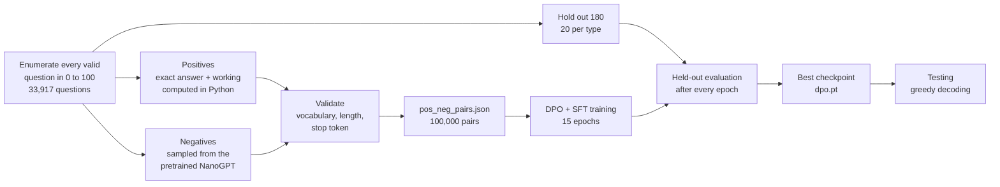

# Teaching a Tiny GPT to Do Math with Direct Preference Optimization

This project takes a small, character-level GPT model that answers every maths question with *"Sorry, I don't know."* and fine-tunes it with **Direct Preference Optimization (DPO)** until it can solve arithmetic and simple algebra on its own, showing its working along the way.

```
17+19=?      The answer is 36 because 17+19 equals 36.
3*17=?       The answer is 51 because 3*17 equals 51.
72-x=34,x=?  The answer is 38 because 72-34 equals to 38.
x/10=6,x=?   The answer is 60 because 6*10 equals to 60.
```

## Background

This was built as a lab project for NTU module **SC3000 Artificial Intelligence**. The brief was to take a pretrained NanoGPT, build a dataset of preferred and rejected answers, and use preference-based fine-tuning to teach it to solve maths problems.

The project is a hands-on look at the same idea used to align large language models such as ChatGPT: instead of only showing a model the right answer, it is shown pairs of a good and a bad response and trained to prefer the good one. Working with a model of only 8.8 million parameters, on a laptop, makes every design decision visible. Small choices about the data, the learning rate or how answers are decoded have a direct and measurable effect on whether the model learns at all.

## Results

| | First training run | Final model |
|---|---|---|
| Course test prompts | 1 / 8 correct | **8 / 8 correct** |
| Held-out questions (never seen in training) | 41.1% | **100% (180 / 180)** |
| Accuracy per question type | between 5% and 70% | **20 / 20 for all 9 types** |

To make sure the result was genuine, the final model was also checked with a separate evaluation script that plugs each predicted answer back into the original question and verifies the arithmetic in the working. It scored 180 / 180 with greedy decoding, 180 / 180 with random sampling (temperature 0.8, top-k 200), and 1000 / 1000 on a random sample of training questions.

## How it works



In short, every possible question in the range is generated, a small set is kept aside for testing, and each remaining question is paired with a correct answer and the model's original refusal. The model is then trained to prefer the correct answer, and its accuracy on the unseen questions is checked after every epoch so the best version can be kept.

## The model

| Property | Value |
|---|---|
| Architecture | Decoder-only transformer (nanoGPT) |
| Layers / attention heads / embedding size | 6 / 6 / 348 |
| Context length | 256 characters |
| Tokenizer | Character-level, 74 symbols (`sft/meta.pkl`) |
| Parameters | 8.8M |
| Starting point | A pretrained chat model (`sft/gpt.pt`) |

Like any GPT, the model writes one character at a time, and each character is predicted from everything that came before it:

$$P(x_1, \ldots, x_n) = \prod_{i=1}^{n} P(x_i \mid x_1, \ldots, x_{i-1}; \theta)$$

Because it works on single characters, a number like 36 is two separate predictions, `3` and then `6`, and both have to be right. Generation stops as soon as the model writes a full stop or a newline, which shapes how the training data is formatted.

## Building the dataset

**Why limit the range to 0 to 100.** Keeping every number in the question and the answer within 0 to 100 helps in two ways. First, no answer is longer than three digits, which keeps the task realistic for a model that has to get every digit right one after another. Second, the range is small enough to list every possible question rather than sampling random ones. Random sampling would repeat some questions and miss others, while a complete list means the model practises on exactly the kind of questions it will be tested on. In machine learning terms, the training distribution matches the test distribution, $P_{tr}(x,y) = P_{ts}(x,y)$.

**Question types.** Looping over every pair of numbers from 0 to 100 produces nine types of questions. For the algebra questions, the working shows how to undo the operation to find x.

| Type | Example | Correct reply | Count |
|---|---|---|---|
| `a+b=?` | `17+19=?` | `The answer is 36 because 17+19 equals 36.` | 5,151 |
| `a-b=?` | `79-7=?` | `The answer is 72 because 79-7 equals 72.` | 5,151 |
| `a*b=?` | `3*17=?` | `The answer is 51 because 3*17 equals 51.` | 683 |
| `a/b=?` | `72/4=?` | `The answer is 18 because 72/4 equals 18.` | 582 |
| `x+a=b`, `a+x=b` | `x+55=95,x=?` | `The answer is 40 because 95-55 equals to 40.` | 10,302 |
| `x-a=b` | `x-18=21,x=?` | `The answer is 39 because 21+18 equals to 39.` | 5,151 |
| `a-x=b` | `72-x=34,x=?` | `The answer is 38 because 72-34 equals to 38.` | 5,151 |
| `x*a=b`, `a*x=b` | `x*11=44,x=?` | `The answer is 4 because 44/11 equals to 4.` | 1,164 |
| `x/a=b` | `x/10=6,x=?` | `The answer is 60 because 6*10 equals to 60.` | 582 |

Division questions are built backwards: the answer is chosen first and multiplied out to create the question, so every division comes out to a whole number. Questions that would go below zero or divide by zero are left out. In total there are 33,917 questions, and 180 of them (20 of each type) are held out and never used for training.

**Correct answers (positives)** are calculated in Python rather than written by a chatbot. This guarantees that all 100,000 answers are correct and formatted the same way, since even a handful of wrong answers would teach the model the wrong thing.

**Rejected answers (negatives)** come from the pretrained model itself. When asked 1,000 of the questions, it refused every time, usually with "Sorry, I don't know." and occasionally with slight variations such as "Sory, I don't know." Those real replies are used directly, and the rest of the pairs use its most common reply. Training against what the model actually says is what allows DPO to move it away from that behaviour.

**Validation.** Before saving, every pair is checked for three problems that the provided training code would not report as errors:

1. Every character has to be in the model's 74-symbol vocabulary. The course's sample data used `!`, which is not, and caused the encoder to crash.
2. Every sequence has to fit in 64 characters once four end-of-sequence newlines are added. Longer sequences are trimmed from the front, which would quietly cut off the question.
3. Every correct answer can contain only one full stop, because the model stops writing at the first one.

The final dataset has 100,000 pairs covering all 33,737 training questions about three times over, and none of the held-out questions appear in it.

## Training objective

For each question $x$, the model sees a preferred reply $y_w$ (the correct answer) and a rejected reply $y_l$ (the refusal). The loss has two parts:

$$\mathcal{L} = -\log \sigma\!\left(\frac{\bar{\ell}_\theta(y_w \mid x) - \bar{\ell}_\theta(y_l \mid x)}{\beta}\right) \;-\; \lambda \, \bar{\ell}_\theta(y_w \mid x), \qquad \beta = 0.5,\ \lambda = 0.1$$

Here $\bar{\ell}_\theta$ is the average log-probability per character that the model gives to a reply.

The **first part (DPO)** looks at how much more likely the model finds the correct reply than the refusal, and gets smaller as that gap grows. It works in a similar way to policy gradient methods in reinforcement learning, which make high-reward actions more likely and low-reward ones less likely. The difference is that DPO learns directly from pairs of good and bad answers, so no separate reward model is needed.

The **second part (SFT)** is ordinary language-model training on the correct reply. This turned out to be important. The model stops refusing within about 100 training steps, and from then on the DPO part has very little left to push against, so most of the learning of the actual digits comes from this second part.

This is a simplified version of the original DPO method (Rafailov et al., 2023), which also compares the model against a frozen copy of itself, written as $\log \frac{\pi_\theta(y \mid x)}{\pi_{ref}(y \mid x)}$. The reference model is left out here.

## Training setup

| Setting | Value |
|---|---|
| Optimizer | AdamW, weight decay 0.01 |
| Batch size | 64 pairs |
| Epochs / total steps | 15 / 23,430 |
| Peak learning rate | 1e-3 |
| Learning rate schedule | 300-step linear warm-up, then cosine decay to 1e-4 |
| Gradient clipping | 1.0 |
| Dropout | 0 (the pretrained model used 0.2) |
| Checkpointing | saved after each epoch only if held-out accuracy did not drop |
| Hardware / time | Apple M-series GPU (MPS), about 127 minutes |

The learning rate starts near zero, rises over the first 300 steps, and then slowly falls along a cosine curve. The warm-up avoids large, unstable updates at the start, and the gradual decay lets the model take big steps early on and fine-tune its answers towards the end:

$$\eta(t) = \begin{cases} \eta_{max} \cdot \dfrac{t+1}{T_w} & t < T_w \\[2mm] \eta_{min} + \tfrac{1}{2}(\eta_{max} - \eta_{min})\left(1 + \cos\!\left(\pi \, \dfrac{t - T_w}{T - T_w}\right)\right) & t \ge T_w \end{cases}$$

Dropout was turned off because its job is to stop a model from memorising training data that differs from what it will be tested on. Since the training data here already contains every question that can be asked, that risk does not apply, and dropout would only make it harder to learn exact digits.

## How the model learned

| Epoch | 1 | 2 | 3 | 4 | 5 | 6 | 7 | 8 | 9 | 10 | 11 | 12 | 13 | 14 | 15 |
|---|---|---|---|---|---|---|---|---|---|---|---|---|---|---|---|
| Held-out accuracy (%) | 28.3 | 69.4 | 81.7 | 80.0 | 79.4 | 86.1 | 92.2 | 95.6 | 94.4 | 96.7 | 99.4 | 97.8 | 99.4 | 100 | 100 |

The model picked up the answer format within the first epoch and most of the arithmetic by the third. Accuracy levelled off for a couple of epochs while the learning rate was still high, then climbed steadily to 100% as the learning rate came down.

The training loss turned out to be a poor guide to progress. It dropped from about 10 to below 0.1 within a few hundred steps and then stayed near 0.02 for the rest of training. This happens because the loss is averaged over every character, including the digits in the question itself, which are random and can never be predicted. That is why held-out accuracy was measured after every epoch instead.

## What changed along the way

| Run | What was tried | Held-out accuracy |
|---|---|---|
| First run | Course defaults: learning rate 1e-4, 5 epochs, dropout 0.2, random sampling at test time | 32.8% |
| First run + greedy decoding | Always picking the most likely next character at test time | 41.1% |
| Wrong answers as negatives | Rejecting replies like "The answer is 48" instead of refusals | 28.9% |
| Stronger SFT term | Raising λ from 0.1 to 1.0 | 41.1% |
| **Final** | Learning rate 1e-3 with warm-up and cosine decay, 15 epochs, no dropout, gradient clipping | **100%** |

The first model always answered in the right format but mostly guessed the numbers. More telling, it also got many questions wrong that it had already trained on. That pointed to underfitting rather than a lack of data. In the gradient descent update, $w_{t+1} = w_t - \eta \nabla_w \mathcal{L}$, the step size $\eta$ was simply too small for the model to learn the arithmetic in five epochs. Changing the negatives or rebalancing the loss made no real difference (both were tested in short 300-step runs), while a larger learning rate and longer training solved the problem.

Greedy decoding is used for testing because every question has exactly one correct answer, so random sampling can only add mistakes.

## Limitations

- The held-out set has 180 questions, which is fairly small. A score of 100% shows the model is very accurate, but it is not proof that it would get every possible question right.
- The held-out set was also used to decide which checkpoint to keep, which can make results look slightly better than they are. In this case the final epoch also scored 100%, so the choice made no difference.
- Held-out questions have not been seen in their exact form, but very similar ones may have been, for example `44+x=97,x=?` when `x+44=97,x=?` is held out.
- The model only knows the format and range it was trained on. Questions with spaces, numbers above 100, or more than one step are outside what it has learned.

## Repository structure

```
├── dpo/
│   ├── dpo.ipynb            # full pipeline: data generation, training, evaluation and analysis
│   ├── dpo.pt               # fine-tuned model
│   └── pos_neg_pairs.json   # 100,000 preference pairs
├── sft/
│   ├── gpt.pt               # pretrained model (not included, see below)
│   └── meta.pkl             # character vocabulary
├── model.py                 # nanoGPT model definition (unchanged)
└── configurator.py          # nanoGPT config helper (unchanged)
```

## Running the project

1. Download the pretrained model from [this link](https://drive.google.com/file/d/1gIZw-HAB-tHtEYCmNugwlIV7R3WsgjjZ/view?usp=sharing) and save it as `sft/gpt.pt`. It is not included in the repository because it is larger than GitHub's 100 MB file limit.
2. Install the dependencies: `pip install torch numpy matplotlib tqdm`
3. Open Jupyter from inside the `dpo/` folder, since the notebook uses relative paths like `../sft/gpt.pt`, and run all cells. It runs on CUDA, Apple MPS or CPU.

To test the included `dpo.pt` without retraining, run the setup cells and Task 1a, then skip straight to the testing section.

## References

- R. Rafailov, A. Sharma, E. Mitchell, S. Ermon, C. D. Manning, C. Finn. *Direct Preference Optimization: Your Language Model is Secretly a Reward Model.* NeurIPS 2023. https://arxiv.org/abs/2305.18290
- A. Karpathy. *nanoGPT.* https://github.com/karpathy/nanoGPT (model definition and learning rate schedule)
- SC3000 course base code and pretrained model: https://github.com/zhouyuan888888/NanoGPT-Math
